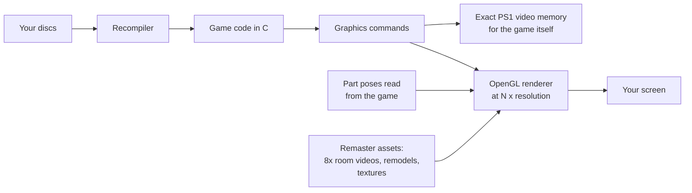

# How it works

People ask how the remodelled characters stay rock-steady when the PlayStation's 3D famously wobbles. This page
explains that, and the rest of what happens between your disc and the picture on screen. It is about ideas and where
to find them in the code, not a recipe for rebuilding the assets.

- [The port in one paragraph](#the-port-in-one-paragraph)
- [Why PlayStation 3D wobbles](#why-playstation-3d-wobbles)
- [Stable models: taking the pose, not the pixels](#stable-models-taking-the-pose-not-the-pixels)
- [Drawing the remodel](#drawing-the-remodel)
- [Removing the game's own jitter](#removing-the-games-own-jitter)
- [60 fps motion from a 30 fps game](#60-fps-motion-from-a-30-fps-game)
- [Backgrounds and cutscenes](#backgrounds-and-cutscenes)
- [How the remodels are made](#how-the-remodels-are-made)
- [Where to look in the code](#where-to-look-in-the-code)

## The port in one paragraph

The installer reads the game's program from your discs and translates it, ahead of time, into C code
(static recompilation). That code is compiled together with a runtime that stands in for the console: the CPU's
helpers, the CD drive, the sound chip, memory cards, and the graphics chip. The graphics chip is emulated twice:
an exact software copy keeps the console's video memory correct for the game, and an OpenGL renderer redraws
every frame at a higher resolution for your screen. The remaster hooks into that second path.

## Why PlayStation 3D wobbles

Three limits of the original hardware cause the familiar look:

1. **Whole-pixel vertices.** The geometry chip (the GTE) projects every vertex to the screen in integer maths and
   hands the graphics chip whole pixel positions, with no fractions. As a model moves, each corner jumps from pixel
   to pixel independently, so polygons shimmer and seams open and close.
2. **Affine textures.** Textures are stretched across a triangle in screen space without perspective correction,
   so they swim and bend as the camera angle changes.
3. **No depth buffer.** Polygons are sorted by an approximate depth per polygon, so overlapping parts can pop in
   front of each other.

Rendering the same polygons at a higher resolution doesn't fix any of this, because the positions were already
rounded before the graphics chip saw them.

## Stable models: taking the pose, not the pixels

The fix is to stop using the projected pixels at all for the characters, and take the pose from one step earlier.

Fear Effect draws a character **one body part at a time** (head, upper arm, thigh, and so on). For every part, the
game first loads that part's full 3D transform, a rotation and a position relative to the camera, into the geometry
chip, and only then projects the part's vertices. The port intercepts that moment. It never has to guess a pose from
the screen: it gets the exact transform the game itself used.

To know *which* model and part it is looking at, the port recognises each part once by the drawing commands it
produces (the kinds of polygons and their texture coordinates), compared against a table per original model. That
fingerprint is the same every time the part is drawn, whatever the pose. When two models share identical parts (the
same head in two costumes, a guard that shares a body with a playable character), the model file still in the
console's memory decides which one it is.

## Drawing the remodel

With every part's transform known, the remodel is drawn as a normal modern skinned mesh:

- Each vertex of the new mesh is bound to one or more of the original parts, with weights, so the game's own
  animation drives it exactly, frame by frame. Nothing is re-animated.
- It is drawn by the GPU in floating point, with **perspective-correct textures**, a **depth buffer** and 4x
  multisampling, at the full output resolution. That removes all three causes of wobble at once.
- It is drawn at the same point in the game's drawing order where the original model's first polygon would have
  been. Walls, doors and effects that the game draws later still cover it correctly.
- The original low-poly model's polygons are left out of the high-resolution picture. They stay in the exact
  software copy, because the game sometimes reads its own video memory back.
- The colours follow the game. Every vertex of the remodel knows which original polygon it covers and takes that
  polygon's lit colour from the game each frame. Lighting changes, fades and hit flashes therefore still work, then
  get the remaster's cel shading and ink outline on top.

The rest of the 3D that isn't remodelled is still drawn the PlayStation way, only sharper. An experimental
precise-vertex option (`precision` in [SETTINGS.md](src/SETTINGS.md)) exists for that, off by default. Most of what
you see in these games, though, is pre-rendered rooms plus characters, and the characters take the path above.

## Removing the game's own jitter

Exact poses also expose small shakes that the game itself produces and that were invisible at 320x240. The port
smooths those as presentation only. It never changes what the game computes:

- **Rounded part positions.** The game stores each part's position in whole units, so a head can tremble by one unit
  at every idle loop. While a character moves slowly, that rounding is filtered out.
- **Flat, blinking patches.** The game lights each original polygon with one flat colour and skips polygons that face
  away. The remaster spreads those colours smoothly over the new surface and fills skipped ones from their
  neighbours, so no patches blink on a face or neck.
- **Outlines** have a constant width in screen pixels, thicker at the silhouette, so they don't thicken or vanish
  with distance or resolution.

These are the `model_fix` options in [SETTINGS.md](src/SETTINGS.md). `Ctrl+F8` turns them off live, if you want to
compare.

## 60 fps motion from a 30 fps game

The games update their rooms 30 times a second. Every second screen refresh, the next frame is already finished but
not yet shown, so both the current pose and the next one are known. The port draws an extra frame in between: each
part's rotation is blended along the shortest arc and its position interpolated, halfway between the two poses. The
rest of the picture is reused from the current frame. This adds no input delay. A camera cut or a teleport, where
blending would be wrong, simply shows the game's own frame (`smooth` in [SETTINGS.md](src/SETTINGS.md)).

## Backgrounds and cutscenes

Fear Effect's rooms are pre-rendered video, often animated loops, and its cutscenes are video too. The remaster
replaces them with 8x-resolution versions. The port watches which video frame the game is decoding from the disc
and shows the matching remastered picture. That keeps the remaster in sync with the game frame by frame, including
loops, pauses and jumps. Some room videos also have in-between pictures for 60 fps. During a camera move, characters
are drawn with the camera of the picture actually on screen, so they glide with the background instead of stepping.
The videos are decoded by ffmpeg in the background, ahead of the game.

## How the remodels are made

The models, textures and videos are the work of the Fear Effect Remaster ([feremaster.us](https://feremaster.us/)).
The tools that produce them aren't part of this repository, but the process is:

1. **Start from the game's skeleton.** Each original model is split into its rigid parts. The new mesh is built over
   those parts and keeps exactly the same parts and joints, so the game's animation can drive it unchanged.
2. **Bind the surface.** Every new vertex is weighted to the original parts it should follow, with smooth weights
   at elbows, knees and the neck. Every vertex also records the original polygon it replaces, for the colour hand-over
   described above.
3. **Check in motion, not in a pose.** A remodel can look right standing still and fail when it moves. Each one is
   compared against the original across the game's real animations (walking, running, aiming, cutscene moves), and
   corrected wherever the two drift apart.
4. **Recognition tables.** For every model, a table of its parts' drawing fingerprints lets the port recognise it in
   any pose, as explained above.

Earlier versions of the remaster ran inside an emulator and had to work out each pose from where the projected
points landed on screen. Reading the pose directly, as the port does, is what makes the result exact and stable.

## Where to look in the code

All of this is in this repository under `src/runtime/`:

| File | What it does |
|---|---|
| [`models.c`](src/runtime/models.c) | Intercepts each part's transform, recognises parts and models, poses the remodels, the 60 fps in-between poses. Its opening comment is a good starting point. |
| [`gpu_hw.c`](src/runtime/gpu_hw.c) | The OpenGL renderer: redraws every graphics command at higher resolution, draws the skinned meshes, outlines, multisampling and in-between frames. |
| [`mlook.c`](src/runtime/mlook.c), [`mlook.h`](src/runtime/mlook.h) | The look fixes: colour spreading, skipped-polygon fill, rounding filter, outline widths. |
| [`gpu.c`](src/runtime/gpu.c), [`gte.c`](src/runtime/gte.c) | The exact software graphics chip and the geometry chip, as the game expects them. |
| [`movie.c`](src/runtime/movie.c) | Remastered room videos and cutscenes, kept in sync with the game's own video frames. |
| [`texrep.c`](src/runtime/texrep.c) | Replacement textures: interface, fonts, icons. |
| [`src/tools/recomp/`](src/tools/recomp/) | The recompiler that turns the game's program on your disc into C. |

Settings and command-line switches for all of the above (to turn each layer on or off and compare) are in
[SETTINGS.md](src/SETTINGS.md).
